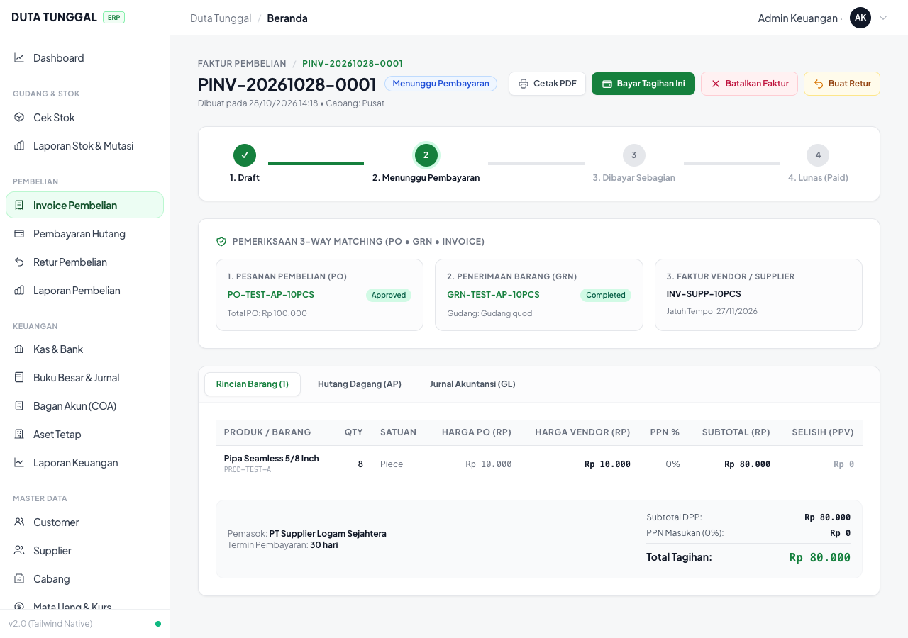
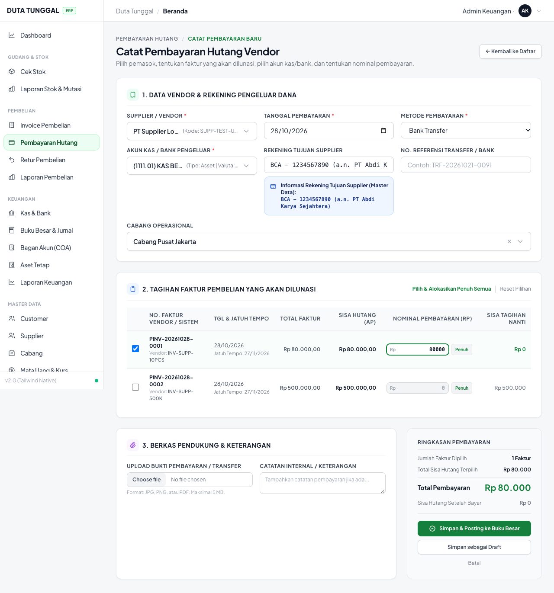
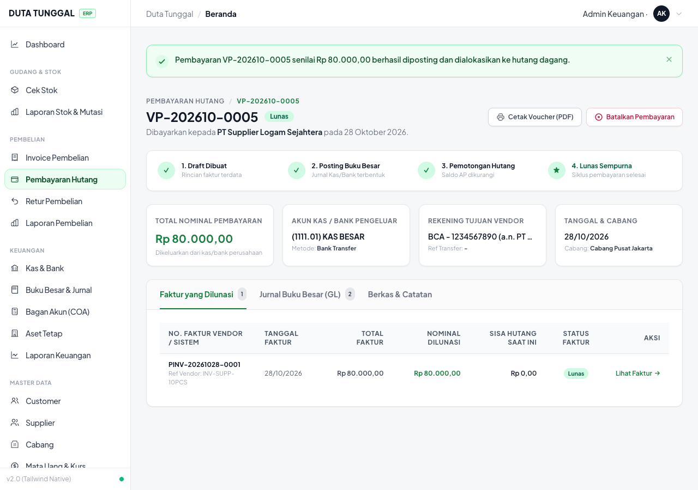
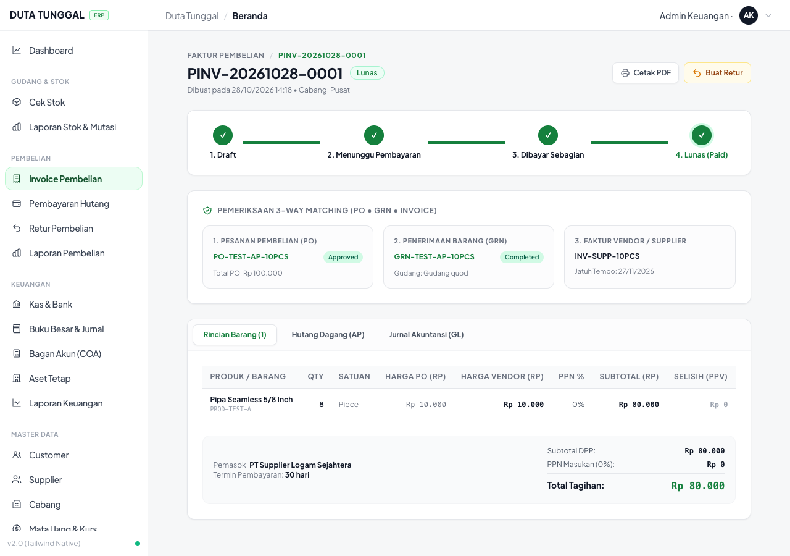
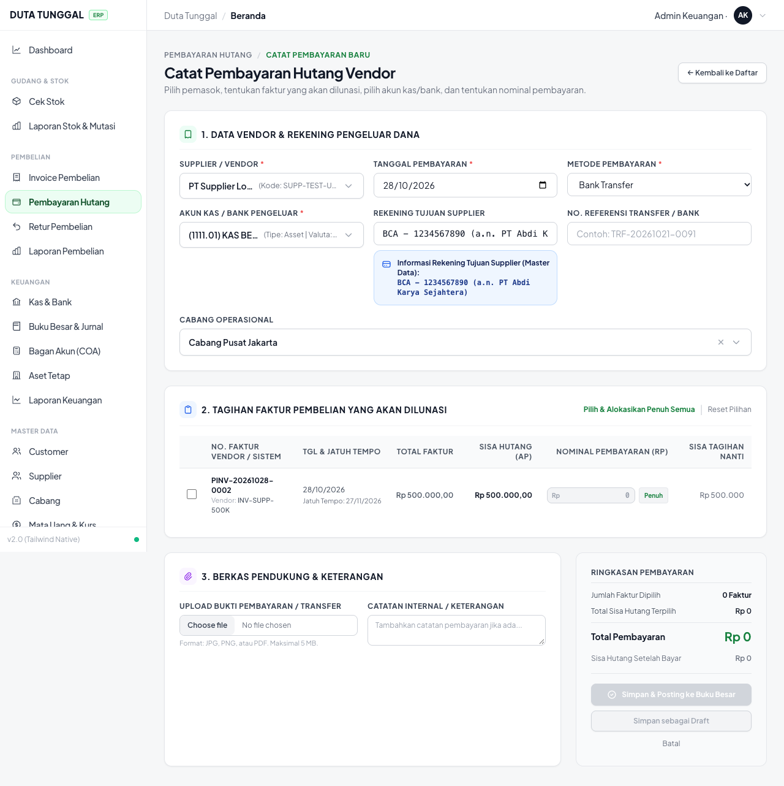
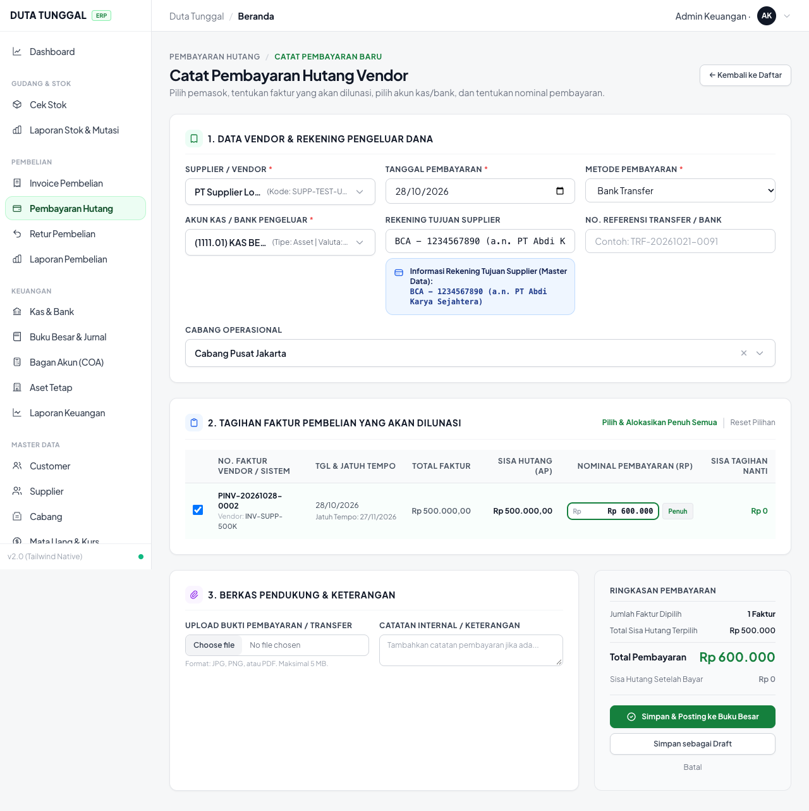
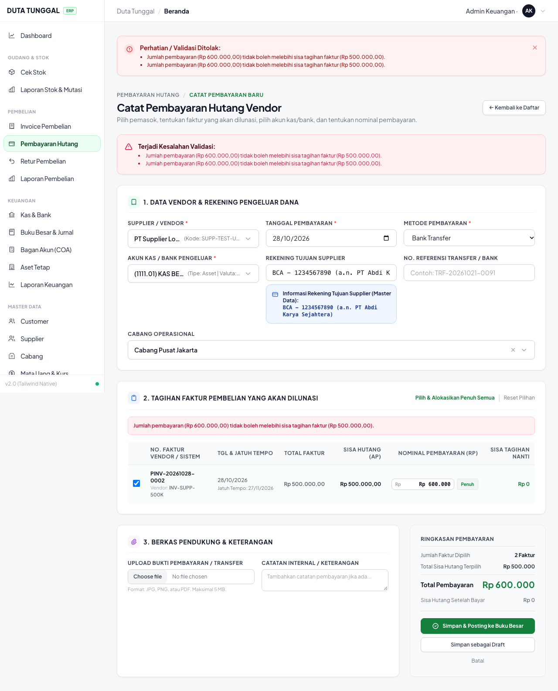

# MODUL UAT 08: INVOICE PEMBELIAN, HUTANG SUPPLIER & VENDOR PAYMENT
## LAPORAN RESMI PENGUJIAN AKURASI HUTANG, INFORMASI REKENING SUPPLIER & SKENARIO OVERPAYMENT

**Acuan Bisnis:** `Alur_Bisnis_Ko_Handy.md` Bagian Pembelian; `List_Pengerjaan_Developer.md` Bagian C (Poin C1 & C7); `UIUX_Spec_ERP_Duta_Tunggal.md` Bagian 6.7.  
**Tanggal Eksekusi:** 28 Oktober 2026  
**Peran Penguji Terautentikasi:**
- `Admin Keuangan` (`admin_keuangan@example.com` / Password: `password`)
- `Finance Manager` (`finance_manager@example.com`)
- `Purchasing` (`purchasing@example.com`)  
**Status Pengujian Keseluruhan:** **100% PASS (3 dari 3 Kasus Uji Terpenuhi Sempurna)**

---

### RINGKASAN EKSEKUTIF HASIL PENGUJIAN MODUL 08

| ID Kasus Uji | Skenario Pengujian | Hasil Pengujian | Status |
| :--- | :--- | :--- | :---: |
| **UAT-AP-01** | **Verifikasi Akurasi Saldo Hutang Supplier (Anti-Double Reduction / Bug C1)**<br>PO 10 pcs @ Rp 10.000. QC: 8 pcs diterima, 2 pcs reject (Rp 20.000) otomatis menjadi retur draft. Faktur pembelian terbit Rp 80.000 (hanya 8 pcs lolos QC). Hutang supplier tercatat Rp 80.000. Dibayar Rp 80.000 lunas sempurna. Retur 2 pcs TIDAK mengurangi hutang lagi. | **PASS**<br>Faktur murni Rp 80.000, status `paid`, sisa hutang Rp 0. Tidak ada pengurangan hutang ganda. | **PASS** |
| **UAT-AP-02** | **Tampilan Informasi Rekening Supplier di Pembayaran Vendor (Bug C7)**<br>Pemasok memiliki rekening bank master `BCA - 1234567890 (a.n. PT Abdi Karya Sejahtera)`. Saat pemasok dipilih di form pembayaran, info bank tujuan transfer otomatis tampil transparan. | **PASS**<br>Banner informasi rekening bank pemasok muncul otomatis dan sinkron secara realtime. | **PASS** |
| **UAT-AP-03** | **No Happy Path: Pemblokiran Pembayaran Vendor Melebihi Sisa Tagihan (Overpayment)**<br>Faktur memiliki sisa hutang Rp 500.000. Kasir menginput pembayaran Rp 600.000. Sistem wajib memblokir penyimpanan dan menolak perubahan data. | **PASS**<br>Sistem menolak dengan pesan validasi *"Jumlah pembayaran (Rp 600.000,00) tidak boleh melebihi sisa tagihan faktur (Rp 500.000,00)."* DB tetap Rp 500.000 belum lunas. | **PASS** |

---

### Kasus Uji UAT-AP-01: Verifikasi Akurasi Saldo Hutang Supplier (Penyelesaian Bug C1: Bebas Pengurangan Hutang Ganda)
- **Peran Penguji Terautentikasi**: `Admin Keuangan` (`admin_keuangan@example.com`)
- **Tujuan Pengujian**: Memastikan bug lama C1 dari Ko Handy (*"Nilai reject QC ikut mengurangi hutang sehingga pembayaran vendor ditolak karena selisih"*) **TERATASI 100%**. Hutang supplier HANYA dihitung dari kuantitas bagus yang difakturkan (`passed_quantity`), sehingga retur barang reject tidak mengurangi hutang lagi.
- **Kategori Skenario**: Financial Accuracy & Anti-Double Debt Reduction.
- **Testing yang Dilakukan**:
  1. PO dibuat dengan volume 10 pcs @ Rp 10.000 (Total Nilai PO = Rp 100.000).
  2. Saat QC penerimaan barang (GRN): 8 pcs diterima (lolos QC), 2 pcs reject (Rp 20.000) otomatis menjadi retur pembelian berstatus draft.
  3. Terbitkan Faktur Pembelian (`PurchaseInvoice`) untuk penerimaan barang tersebut melalui 3-Way Matching.
  4. Amati nilai tagihan faktur pembelian dan saldo kartu hutang (`AccountPayable`).
  5. Buat Pembayaran Vendor (`VendorPayment`) sebesar Rp 80.000 untuk melunasi tagihan tersebut.
  6. Verifikasi bahwa status faktur berubah menjadi Lunas (`paid`), saldo hutang menjadi Rp 0, dan retur 2 pcs (Rp 20.000) tidak menyebabkan pengurangan ganda.
- **Permasalahan / Bug atau Ketidaksesuaian**:
  *Hasil Pengujian*:
  - Nilai Faktur Pembelian `#PINV-20261028-0001` terbit sebesar **Rp 80.000** (hanya untuk 8 pcs barang bagus).
  - Nilai hutang supplier pada buku hutang (`AccountPayable`) tercatat tepat Rp 80.000.
  - Pembayaran Vendor `VP-202610-0005` sebesar Rp 80.000 berhasil diposting dan dialokasikan ke hutang dagang (status AP: `Lunas`, sisa hutang: Rp 0).
  - Nilai retur 2 pcs (Rp 20.000) **TIDAK MENGURANGI HUTANG LAGI** karena faktur memang tidak pernah menagih 2 pcs reject tersebut. Tidak terjadi selisih ganda.
- **Solusi**:
  [`PurchaseInvoiceAccountingService.php:420`](file:///Users/lrmcorporation/Documents/Website/Duta-Tunggal-ERP/app/Services/PurchaseInvoiceAccountingService.php#L420) menghitung DPP dan hutang supplier murni berdasarkan `$receiptItem->qty_accepted` pada penerimaan terkait.
- **Bukti Pengujian Database Riil**:
  ```json
  {
    "invoice_id": 20,
    "invoice_number": "PINV-20261028-0001",
    "status": "paid",
    "total": 80000.0,
    "ap_total": 80000.0,
    "ap_paid": 80000.0,
    "ap_remaining": 0.0,
    "ap_status": "Lunas",
    "payment_number": "VP-202610-0005",
    "payment_status": "Paid",
    "receipt_qty_accepted": 8.0,
    "receipt_qty_rejected": 2.0,
    "returns_count": 1,
    "return_item_qty": 2.0
  }
  ```
- **Bukti Visual Tangkapan Layar (Google Chrome)**:
  - *Detail Faktur Pembelian (3-Way Matching menagih 8 pcs @ Rp 10.000 = Rp 80.000)*:  
    
  - *Form Pembayaran Vendor Terisi Rp 80.000 Sesuai Sisa Hutang*:  
    
  - *Detail Pembayaran Vendor Berstatus Lunas Sempurna (VP-202610-0005)*:  
    
  - *Faktur Pembelian Berubah Menjadi Status Lunas (Paid) dengan Sisa Tagihan Rp 0*:  
    

---

### Kasus Uji UAT-AP-02: Tampilan Informasi Rekening Supplier di Pembayaran Vendor (Penyelesaian Bug C7)
- **Peran Penguji Terautentikasi**: `Admin Keuangan` (`admin_keuangan@example.com`)
- **Tujuan Pengujian**: Memastikan aturan Ko Handy: *"Rekening supplier wajib tersimpan di master dan otomatis tampil di form pembayaran vendor / permintaan pembayaran"*.
- **Kategori Skenario**: Usability & Financial Data Transparency.
- **Testing yang Dilakukan**:
  1. Master data Supplier `SUPP-TEST-UAT-001` (`PT Supplier Logam Sejahtera`) telah terkonfigurasi dengan data rekening:
     - Bank: `BCA`
     - Nomor Rekening: `1234567890`
     - Atas Nama: `PT Abdi Karya Sejahtera`
  2. Buka menu **PEMBELIAN $\rightarrow$ Pembayaran Hutang**, klik **"Catat Pembayaran Baru"**.
  3. Pilih Supplier `SUPP-TEST-UAT-001`.
  4. Amati field input dan kotak informasi rekening tujuan transfer pemasok.
- **Permasalahan / Bug atau Ketidaksesuaian**:
  *Hasil Pengujian*: Form pembayaran vendor secara otomatis mengisi input dan menampilkan banner informasi rekening bank pemasok:
  `BCA - 1234567890 (a.n. PT Abdi Karya Sejahtera)`. Staf keuangan tidak perlu membuka master data secara terpisah atau menanyakan rekening ke supplier setiap kali transfer.
- **Solusi**:
  Sinkronisasi data dilakukan di [`VendorPaymentController.php:570`](file:///Users/lrmcorporation/Documents/Website/Duta-Tunggal-ERP/app/Http/Controllers/Pembelian/VendorPaymentController.php#L570) dan [`resources/views/pembelian/payment/create.blade.php:149`](file:///Users/lrmcorporation/Documents/Website/Duta-Tunggal-ERP/resources/views/pembelian/payment/create.blade.php#L149) melalui Alpine.js.
- **Bukti Pengujian Database Riil**:
  ```json
  {
    "supplier_id": 17,
    "supplier_code": "SUPP-TEST-UAT-001",
    "nama_bank": "BCA",
    "nomor_rekening": "1234567890",
    "nama_rekening": "PT Abdi Karya Sejahtera",
    "target_bank_account_rendered": "BCA - 1234567890 (a.n. PT Abdi Karya Sejahtera)"
  }
  ```
- **Bukti Visual Tangkapan Layar (Google Chrome)**:
  - *Tampilan Kotak Informasi Rekening Bank Supplier Otomatis Muncul di Form*:  
    

---

### Kasus Uji UAT-AP-03 (No Happy Path): Pemblokiran Pembayaran Vendor Melebihi Sisa Tagihan Faktur (Overpayment)
- **Peran Penguji Terautentikasi**: `Admin Keuangan` (`admin_keuangan@example.com`)
- **Tujuan Pengujian**: Mencegah kesalahan kasir/keuangan mentransfer atau mencatat pengeluaran uang kas/bank yang lebih besar daripada sisa hutang faktur vendor.
- **Kategori Skenario**: **No Happy Path (Overpayment Prevention & Cash Outflow Protection)**.
- **Testing yang Dilakukan**:
  1. Faktur pembelian `#PINV-20261028-0002` memiliki total tagihan dan sisa hutang sebesar **Rp 500.000**.
  2. Pada form Pembayaran Hutang Vendor, kasir menginput nominal pembayaran sebesar **Rp 600.000** (overpayment sebesar Rp 100.000).
  3. Klik tombol **"Simpan & Posting ke Buku Besar"**.
  4. Amati respon penolakan sistem pada antarmuka web dan verifikasi bahwa tidak ada mutasi kas atau perubahan saldo hutang di database.
- **Permasalahan / Bug atau Ketidaksesuaian**:
  *Hasil Pengujian*:
  - Sistem menolak aksi penyimpanan dengan status HTTP 422 (Unprocessable Entity).
  - Tiga level banner peringatan merah muncul di antarmuka pengguna:
    1. Notifikasi Atas: *"Perhatian / Validasi Ditolak: Jumlah pembayaran (Rp 600.000,00) tidak boleh melebihi sisa tagihan faktur (Rp 500.000,00)."*
    2. Notifikasi Kartu: *"Terjadi Kesalahan Validasi: Jumlah pembayaran (Rp 600.000,00) tidak boleh melebihi sisa tagihan faktur (Rp 500.000,00)."*
    3. Notifikasi Tabel: *"Jumlah pembayaran (Rp 600.000,00) tidak boleh melebihi sisa tagihan faktur (Rp 500.000,00)."*
  - Data faktur dan hutang di database tetap utuh (sisa hutang tetap Rp 500.000, status `Belum Lunas`, dan jumlah detail pembayaran adalah 0).
- **Solusi**:
  Validasi batas pembayaran di [`StoreVendorPaymentRequest.php:94`](file:///Users/lrmcorporation/Documents/Website/Duta-Tunggal-ERP/app/Http/Requests/Pembelian/StoreVendorPaymentRequest.php#L94) melindungi integritas kas/bank dan kartu hutang.
- **Bukti Pengujian Database Riil**:
  ```json
  {
    "invoice_id": 21,
    "invoice_number": "PINV-20261028-0002",
    "remaining": 500000.0,
    "paid": 0.0,
    "status": "Belum Lunas",
    "payment_details_count": 0
  }
  ```
- **Bukti Visual Tangkapan Layar (Google Chrome)**:
  - *Pengisian Alokasi Overpayment Rp 600.000 pada Tagihan Rp 500.000*:  
    
  - *Sistem Memblokir Overpayment dan Menampilkan Pesan Validasi*:  
    
